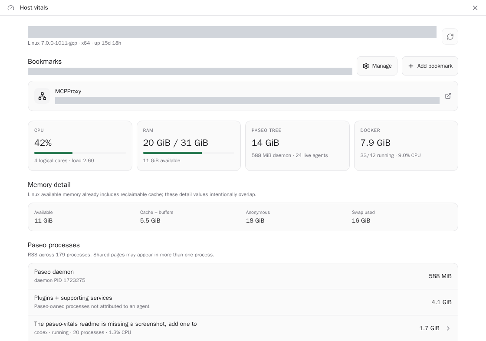

# paseo-vitals

[](https://www.npmjs.com/package/paseo-vitals)
[](https://www.npmjs.com/package/paseo-vitals)
[](https://paseo.sh)
[](LICENSE)

A small Paseo sidebar dashboard for answering one question: how is this development VM doing?



Live usage on a Linux Paseo host. Private host addresses are redacted.

It shows:

- host CPU, load, uptime, RAM detail, swap, and root-disk usage;
- Paseo daemon/plugin RSS separately from agent process trees;
- per-agent RSS, CPU, process count, provider, and status;
- Docker container CPU, cgroup memory, state, PIDs, network I/O, and block I/O;
- the host's largest processes by RSS.

On Linux the plugin reads `/proc` directly. On macOS it uses `ps`, `vm_stat`, and
`sysctl vm.swapusage`, and reports RAM the way Activity Monitor does: app memory, wired memory,
and compressed memory count as used, and cached files count as available. It invokes
`docker stats` at most once per cached refresh. It reads only the `PASEO_AGENT_ID` environment
entry needed to attribute a process tree; command lines and other process environment values are
never returned to the client.

## Install

Install from npm using the latest Paseo release:

```sh
paseo plugin install paseo-vitals
```

## Use

Open **Host vitals** from Paseo's sidebar. The dashboard refreshes every five seconds while mounted.
Docker failure is non-fatal, and process-level detail degrades gracefully on hosts other than Linux and macOS.

## Development

```sh
npm ci
npm run verify
paseo plugin install paseo-vitals
```

## License

[MIT](LICENSE) © 2026 Tom Gringauz.

## Navigation and display

Open this plugin from Command-K or its sidebar entry. **Overview** and **Display settings** link the main view and settings directly, without opening the Plugins settings page. Hiding a sidebar entry keeps Command-K available.

## Paseo 0.14 agent integration

`vitals_host_snapshot` exposes host and Docker health without process environments or command lines. Agent enumeration now follows every page, including hosts with more than 200 sessions.

Requires Paseo **0.14.0 or newer**. Agent tools are scoped to interactive Claude
and Codex sessions; history-only opens receive none. They become available on
the next idle session open after install or reload. The agent label
`plugin-tools/enabled: "false"` opts a session out. Existing plugin data and
settings are retained.

## Other plugins

- [Defer](https://github.com/tomgrin10/paseo-defer) — Schedule messages for later delivery.
- [Graphite](https://github.com/tomgrin10/paseo-graphite) — Graphite stacks and PR status.
- [Smart Session](https://github.com/tomgrin10/paseo-smart-session) — Context compaction and usage insights.
- [Session Guard](https://github.com/tomgrin10/paseo-session-guard) — Pause at session limits and continue after reset.
- [Transfer](https://github.com/tomgrin10/paseo-transfer) — Copy or move workspaces between hosts.
- [Transcript Search](https://github.com/tomgrin10/paseo-transcript-search) — Search conversations across connected hosts.
- [Send to Paseo](https://github.com/tomgrin10/send-to-paseo) — Send GitHub and Graphite PRs to Paseo from Chrome.
- [Dispatch](https://github.com/tomgrin10/paseo-dispatch) — Route tasks to existing workspaces (development preview).

- [Follow-up](https://github.com/tomgrin10/paseo-follow-up) — Track workspace PRs, remaining tasks and completion.
