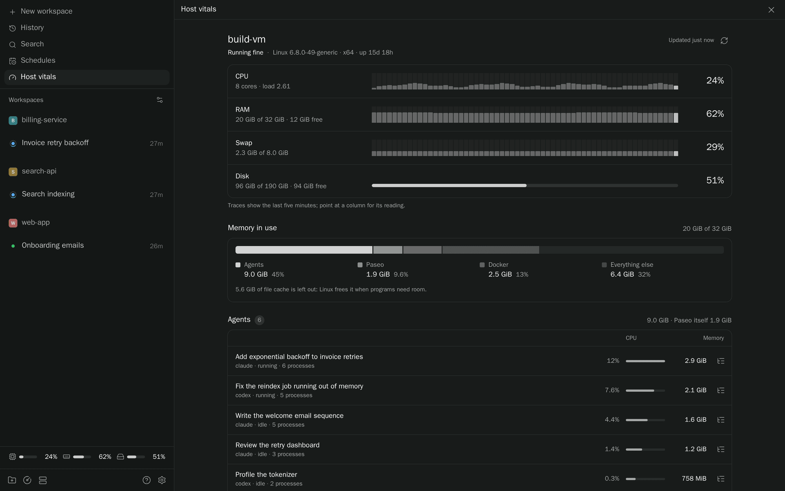
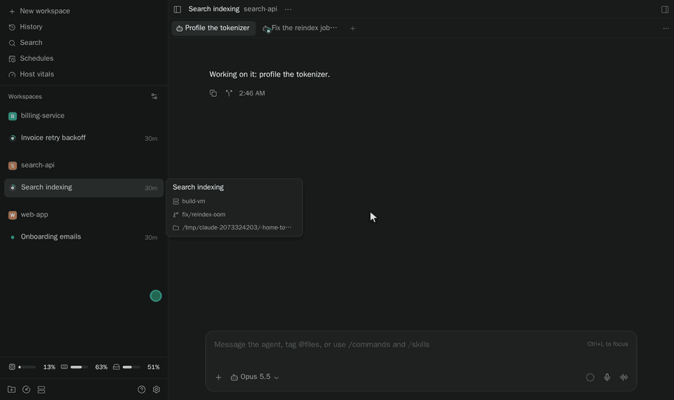
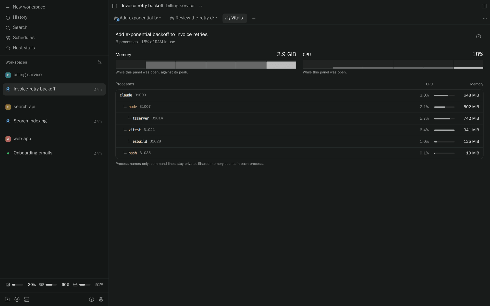
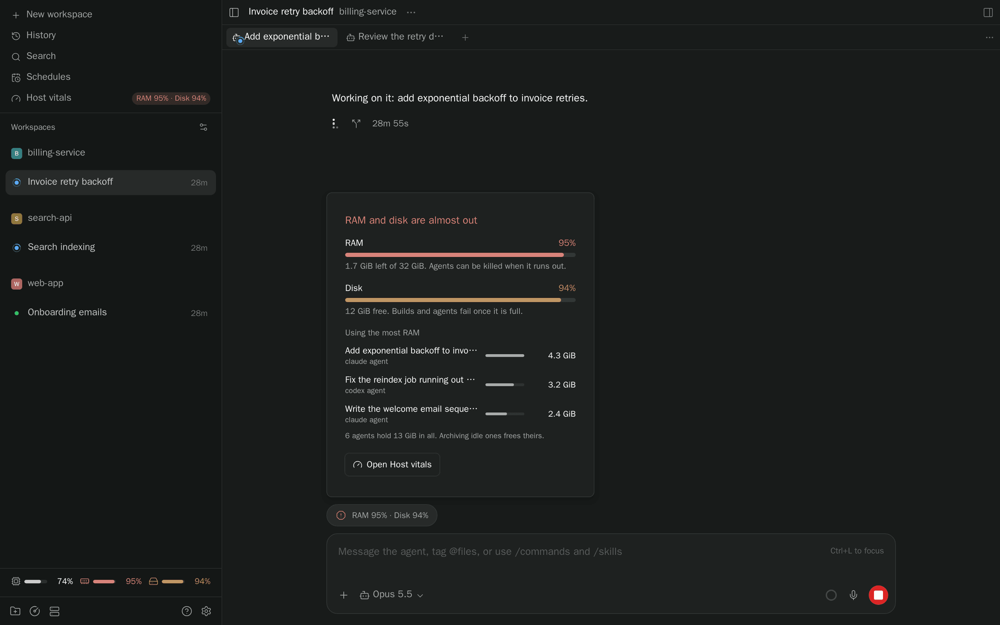
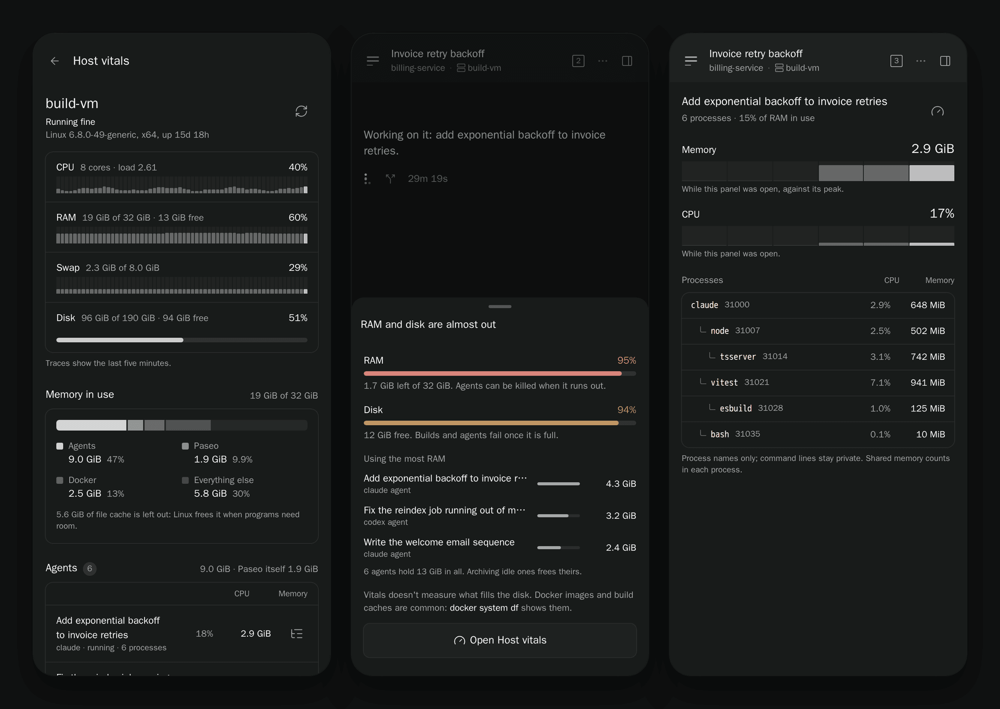

# paseo-vitals

[](https://www.npmjs.com/package/paseo-vitals)
[](https://www.npmjs.com/package/paseo-vitals)
[](https://paseo.sh)
[](LICENSE)

How is this machine doing, and who is using it? Live CPU, RAM and disk meters sit in the sidebar. The dashboard splits the RAM in use between your agents, Paseo, Docker and everything else. Each agent's process tree is one click away, and a warning appears on the composer before RAM or disk runs out.

<picture>
  <source media="(prefers-color-scheme: light)" srcset="docs/media/vitals-dashboard-light.png">
  
</picture>

All screenshots use a demo mode with synthetic host data on a local test host, so no real hostnames, processes or containers appear.

## Install

```sh
paseo plugin install paseo-vitals
```

## Use

**Sidebar meters.** CPU, RAM and disk stay visible at the bottom of the sidebar. They turn amber at 90% and red at 95%. Click them for the last five minutes of each.



**Host vitals.** Open it from the sidebar row, the meters' popover or ⌘K (Ctrl+K). It updates every five seconds while open and shows:

- one sentence on whether the machine is coping, then CPU, RAM, swap and disk
- where the RAM in use goes: agents, the Paseo daemon and plugins, Docker, and everything else
- agents ranked by memory, with CPU and process count; click one to open it
- Docker containers with CPU, memory, PIDs, network and block I/O, and the largest processes on the host

**An agent's processes.** The tree button on an agent row, or ⌘K **Show this agent's processes** inside an agent, opens a **Vitals** panel next to it: its process tree with memory and CPU per process, and how both moved while the panel was open.



**When RAM or disk runs low.** At 90%, every open agent's composer gets a pill such as **RAM 95% · Disk 94%**, and the sidebar row gets the same chip. The pill names what is using the most RAM, so you know which agent to stop or archive. It goes away when the pressure does.



On a phone the same screens open as sheets:



Turn the sidebar row, the footer meters or the composer warning off in **Settings → Plugins → Vitals → Display**.

Agents can read the same snapshot with the `vitals_host_snapshot` tool.

## How it works

The meters, their history and the composer warning come from a light sampler that reads `/proc/stat` and `/proc/meminfo` every five seconds, and the root filesystem every 30 seconds. It runs only while a meter, the dashboard or the warning is watching, and stops a minute after the last read. The dashboard reads all of `/proc` and calls `docker stats` at most once per refresh, cached for three seconds. The agent panel reuses that `/proc` reading and never calls Docker.

Memory is resident set size (RSS). Shared pages count once in every process that maps them, so the parts of the memory bar are scaled to fit when they add up to more than the RAM in use. Reclaimable file cache is not counted as used.

Vitals only watches; it never stops or changes a process. On macOS and Windows hosts you get host totals without per-process detail. Docker failures are not fatal.

## Data and access

From each process the plugin reads only `PASEO_AGENT_ID` from its environment, to attribute it to an agent, plus its name from `/proc/<pid>/comm`. Command lines and other environment values never reach the app.

## Development

```sh
npm ci
npm run verify
paseo plugin install .
paseo plugin reload vitals   # after changes
```

Set `PASEO_VITALS_FIXTURE=/path/to/fixture.json` in the daemon's environment to serve synthetic readings instead of this machine's (used for the screenshots). See `server/fixture.ts` for the shape.

## License

[MIT](LICENSE) © 2026 Tom Gringauz.

## Other plugins

- [Defer](https://github.com/tomgrin10/paseo-defer) — Schedule messages for later delivery.
- [Follow-up](https://github.com/tomgrin10/paseo-follow-up) — Track workspace PRs, remaining tasks and completion.
- [Send to Paseo](https://github.com/tomgrin10/send-to-paseo) — Send GitHub and Graphite PRs to Paseo from Chrome.
- [Session Guard](https://github.com/tomgrin10/paseo-session-guard) — Pause at session limits and continue after reset.
- [Smart Session](https://github.com/tomgrin10/paseo-smart-session) — Context compaction and usage insights.
- [Transcript Search](https://github.com/tomgrin10/paseo-transcript-search) — Search conversations across connected hosts.
- [Transfer](https://github.com/tomgrin10/paseo-transfer) — Copy or move workspaces between hosts.
- [Workspace Switcher](https://github.com/tomgrin10/paseo-switcher) — Arc-style Ctrl+Tab between recent workspaces.
