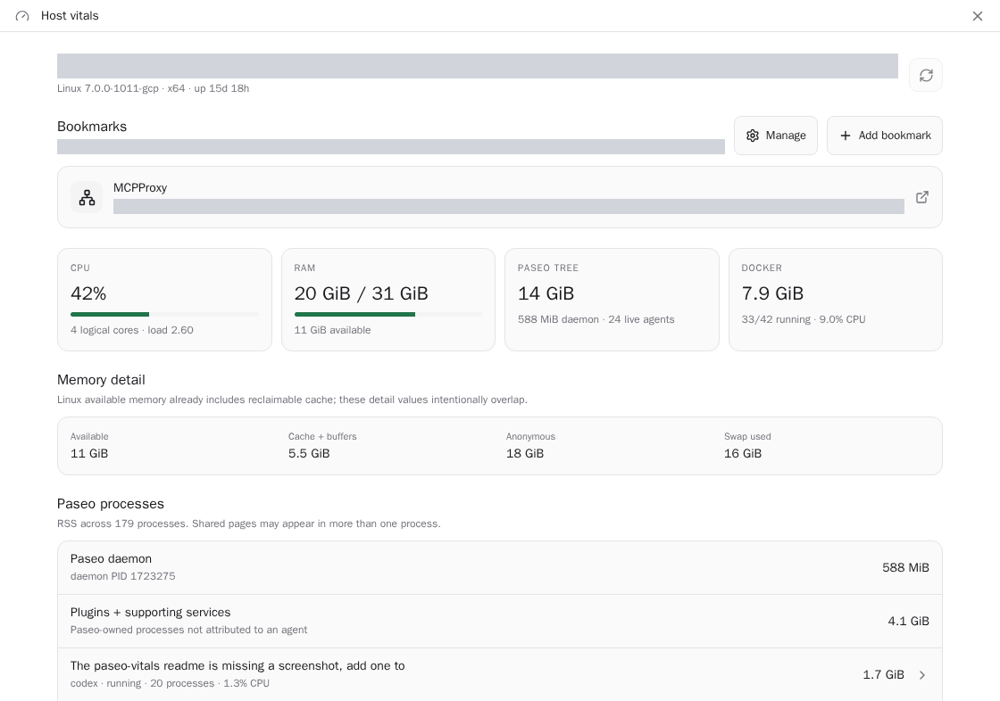

# paseo-vitals

[](https://www.npmjs.com/package/paseo-vitals)
[](https://www.npmjs.com/package/paseo-vitals)
[](https://paseo.sh)
[](LICENSE)

A sidebar dashboard that answers one question: how is this machine doing?



Live usage on a Linux Paseo host. Private host addresses are redacted.

## Install

```sh
paseo plugin install paseo-vitals
```

## Use

Open **Host vitals** from the sidebar or Command Center. It refreshes every five seconds and shows:

- Host CPU, load, uptime, RAM, swap and root disk
- Memory of the Paseo daemon and plugins, separate from agent process trees
- Memory, CPU, process count, provider and status for each agent
- Docker containers with CPU, memory, PIDs, network and block I/O
- The largest processes on the host

Agents can read the same snapshot with `vitals_host_snapshot`.

## How it works

The plugin reads Linux `/proc` directly and calls `docker stats` at most once per refresh. From each process it reads only `PASEO_AGENT_ID`, to attribute it to an agent; command lines and other environment values never reach the client. Docker failures are non-fatal, and process detail degrades gracefully on non-Linux hosts.

## Development

```sh
npm ci
npm run verify
paseo plugin install .
paseo plugin reload vitals   # after changes
```

## License

[MIT](LICENSE) © 2026 Tom Gringauz.

## Other plugins

- [Defer](https://github.com/tomgrin10/paseo-defer) — Schedule messages for later delivery.
- [Follow-up](https://github.com/tomgrin10/paseo-follow-up) — Track workspace PRs, remaining tasks and completion.
- [Send to Paseo](https://github.com/tomgrin10/send-to-paseo) — Send GitHub and Graphite PRs to Paseo from Chrome.
- [Session Guard](https://github.com/tomgrin10/paseo-session-guard) — Pause at session limits and continue after reset.
- [Smart Session](https://github.com/tomgrin10/paseo-smart-session) — Context compaction and usage insights.
- [Transcript Search](https://github.com/tomgrin10/paseo-transcript-search) — Search conversations across connected hosts.
- [Transfer](https://github.com/tomgrin10/paseo-transfer) — Copy or move workspaces between hosts.
- [Workspace Switcher](https://github.com/tomgrin10/paseo-switcher) — Arc-style Ctrl+Tab between recent workspaces.
